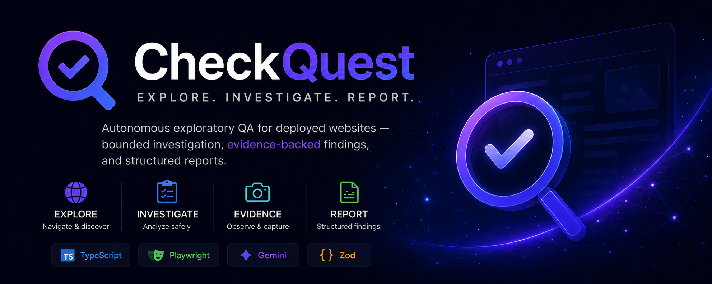

<p align="center">
  
</p>

# CheckQuest 🧭

[](https://github.com/bootnihil/checkquest/actions/workflows/quality.yml)


**Explore. Investigate. Report.**

Your automated tests check what you've already planned for. But what about the
problems you didn't think to test?

CheckQuest takes a different approach. It explores a website, looks for errors
and unexpected behavior, and investigates selected clues. Then it brings back a
report explaining what it found, with supporting evidence you can review.

**Another perspective on your website, without having to anticipate and script
every possible issue yourself.**

CheckQuest is experimental. The command-line version is available from source;
a desktop application is in development.

## ✨ How it works

1. **Explore.** Start with a page of your choice. CheckQuest looks for potential
   problems, such as loading errors, missing headings, and unexpected error
   messages, then follows useful internal links to discover other pages.
2. **Investigate.** When something looks suspicious, CheckQuest can examine
   selected dropdowns, tabs, expandable sections, or text fields to see how they
   behave and gather more information.
3. **Report.** Get readable findings, supporting evidence, and an explanation of
   what still needs human attention.

You choose exploration limits. AI helps identify interesting pages and clues;
built-in policy controls where CheckQuest can go and how it can interact.

## 📄 What you get

| Output | What it gives you |
|---|---|
| `report.md` | Readable findings and observations, affected pages, evidence references, and suggested follow-up |
| `report.json` | Structured results for your own tools and workflows |
| `evidence/` | Focused screenshots when capture is available |

**A suspicion isn't a confirmed problem.** AI can suggest that something looks
wrong. CheckQuest checks for supporting evidence and distinguishes what it
observed from what still needs human judgment. A successful interaction does
not automatically prove the broader claim; findings can remain inconclusive.

Start with the readable report. The [guided demo](docs/DEMO.md) explains how to
interpret it; [report contracts](docs/PUBLIC-CONTRACTS.md#json-report-compatibility)
cover JSON versions and compatibility.

## 🧩 Where it fits

Keep your existing tools:

- **Scripted automated tests** check the requirements and journeys you've already
  defined.
- **Human exploratory testing** brings experience, creativity, and judgment to
  complex questions.
- **Specialist tools** examine areas such as performance, accessibility, and
  security in greater depth.

Add CheckQuest for another exploratory perspective: questions and possible
problems you hadn't anticipated in your test scripts, with evidence to help you
investigate further.

<!-- markdownlint-disable-next-line MD033 -->
<a name="install-from-source"></a>

## 🛠️ Install from source

You'll need Git, Node.js **22.13.0+**, npm **10+**, and network access for
installation, the target website, and the AI provider.

Gemini is currently the only supported AI provider. Bring your own Gemini API
key; provider usage may incur charges.

```sh
git clone https://github.com/bootnihil/checkquest.git
cd checkquest
npm ci
npm run setup:browser
```

On Linux, use `npm run setup:browser:with-deps` if Chromium needs operating-system
libraries. Run CheckQuest from the cloned repository; there is no published npm
package. See [Licensing](#licensing) for the repository's current terms.

## 🎯 Run from the CLI

Set the provider key in the terminal that will start CheckQuest. In PowerShell:

```powershell
$env:GEMINI_API_KEY = "replace-with-your-key"
```

For a POSIX shell, use `export GEMINI_API_KEY="replace-with-your-key"`;
for Windows cmd, use `set GEMINI_API_KEY=replace-with-your-key`.
CheckQuest does not automatically load `.env` files or fall back to
`GOOGLE_API_KEY`. Keep your real key out of source control.

Replace the placeholder below with a complete HTTP(S) URL where automated
testing is permitted, then try a one-page inspection:

```sh
npm start -- https://your-authorized-site.example/ --pages 1 --navigation-steps 1 --steps-per-page 0
```

This inspects the starting page without attempting additional interactive
investigation. Page loading and Gemini analysis still run; this is not an offline
or side-effect-free mode.

Successful runs print the report paths and save files under
`agent-results/<run-id>/` in the working directory. Open the printed Markdown path
first. The [guided demo](docs/DEMO.md) walks through the results and a small second
run with investigation enabled.

Use [Configuration](docs/CONFIGURATION.md#cli-targets-and-budgets) for all flags,
limits, defaults, target profiles, and CLI aliases. The
[provider reference](docs/CONFIGURATION.md#gemini-byok) covers the current model
default and optional overrides.

<!-- markdownlint-disable-next-line MD033 -->
<a name="desktop-gui-in-development"></a>

## 🖥️ Desktop GUI in development

A desktop application is being developed to make CheckQuest easier to use
without typing commands. It is not usable yet, and there is no packaged desktop
installer. For now, use the command-line version and follow
[development progress](docs/ROADMAP-V2.md#g2---local-gui-mvp).

## 🛡️ Safety and limitations

- **Test only where permitted.** Use your own projects, approved client sites, or
  test environments where automated testing is allowed.
- **You set the boundaries.** Page, navigation, and investigation budgets limit
  the work. Navigation follows configured hostnames; ordinary page loads can
  still contact other hosts for resources.
- **Interactions have a purpose.** CheckQuest examines selected controls to
  clarify suspicious details. It provides no arbitrary click, script, login, or
  generic form-submission workflow. Visible password fields suppress interactive
  investigation. Safety checks can reject an action or stop a run.
- **Observation is not attack.** Security-related observations describe what the
  browser received. They are not proof of exploitable vulnerabilities, and
  CheckQuest does not perform penetration testing.
- **Browser automation can have side effects.** Simply visiting a page or
  interacting with a control can trigger website behavior. Safeguards reduce
  risk; they cannot guarantee zero side effects.
- **Handle site data carefully.** Bounded website observations are sent to the AI
  provider, currently Gemini. Reports and screenshots may contain sensitive
  content and URLs. CheckQuest excludes the supplied API key from its reports;
  that is not general anonymization of website data.
- **A run samples a website.** Coverage and AI output vary. Neither a successful
  run nor an empty finding list proves the website is defect-free.

Read [Browser safety](docs/ARCHITECTURE.md#browser-safety) for exact interaction
boundaries and limitations. Safeguards differ by action; the guarded interaction
boundary does not cover every browser operation.

<!-- markdownlint-disable-next-line MD033 -->
<a name="development-and-verification"></a>

## 🧪 Development and verification

```sh
npm run check
npm run test:browser:ci
```

`check` runs formatting, typechecking, ESLint, Markdown lint, and browser-free
deterministic checks. The local Chromium gate uses loopback fixtures and no
Gemini key. `npm test` / `npm run test:ui` is the separate external Aidoc regression
suite.

For internal desktop work, `npm run desktop:check` checks component contracts and
`npm run desktop:build` builds development components. See
[Architecture](docs/ARCHITECTURE.md#verification-layers-and-non-goals) for the
verification layers.

## 📚 Documentation

| Document | Use it for |
|---|---|
| [Guided demo](docs/DEMO.md) | Your first inspection, reading results, and a small exploratory run |
| [Configuration](docs/CONFIGURATION.md) | CLI inputs, budgets, hosts, credentials, and internal desktop contracts |
| [Architecture](docs/ARCHITECTURE.md) | Execution, lifecycle, safety, evidence, and failure behavior |
| [Public contracts](docs/PUBLIC-CONTRACTS.md) | CLI delivery, report compatibility, and machine-consumer requirements |
| [Roadmap](docs/ROADMAP.md) | Planning entry point and completed engine milestones |
| [Roadmap v2](docs/ROADMAP-V2.md) | Current desktop development, acceptance requirements, and later stages |
| [Backlog](docs/BACKLOG.md) | Outstanding, parked, and completed work |

<!-- markdownlint-disable-next-line MD033 -->
<a name="licensing"></a>

## ⚖️ Licensing

The source is publicly viewable, and the package is marked `UNLICENSED`. The
repository does not grant an open-source license or permission to reuse, modify,
or redistribute the code. Installation instructions do not change that status.
Licensing and distribution terms remain an owner decision at the
[product-validation gate](docs/ROADMAP-V2.md#product-validation-gate).
