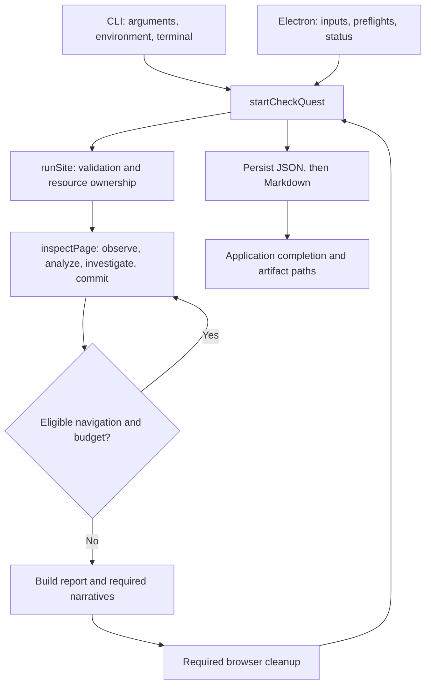

# CheckQuest architecture

This guide explains execution ownership and engineering invariants. Read the
[README](../README.md) for setup, [Configuration](CONFIGURATION.md) for inputs,
and [Public contracts](PUBLIC-CONTRACTS.md) for compatibility requirements.
Source links identify the implementation; they do not define a published SDK.

## Execution boundaries



- [CLI](../agent/run-site-agent.ts) owns argument/environment adaptation,
  terminal rendering, SIGINT cancellation, and process status.
- [Desktop](../desktop/run-controller.ts) owns form input, session credentials,
  credential/reachability preflights, and GUI state. It delegates actual runs.
- [`startCheckQuest`](../agent/application/start-checkquest.ts) owns target
  resolution, budget overrides, cancellation, output sanitization, persistence,
  and application completion.
- [`runSite`](../agent/run/run-site.ts) validates reusable input, owns Chromium,
  diagnostics and registries, coordinates pages, constructs the report, and
  requires cleanup before returning it.
- [`inspectPage`](../agent/inspection/inspect-page.ts) owns one document's
  observations, model analysis, reconciliation, investigation, evidence capture,
  and finding commit.

Core execution does not parse CLI input, render a UI, persist report files,
read a process-global user key, or terminate a process. Screenshot capture
can write evidence during execution. Models, renderers, and compatibility
projections are not separate authorities for finding identity or verification.

## Programmatic `runSite` API

The source-level input is [`RunSiteInput`](../agent/run/run-site.ts):

```ts
const report = await runSite({
  site,
  credentials: { geminiApiKey },
  model,
  signal,
  startedAt,
  runId,
  onEvent,
  dependencies: {
    analyzePageForQa,
    planNextAction,
    chooseNavigationLink,
    generateHumanNarrative
  }
});
```

These names represent caller-supplied values. Only `site` is structurally
required. Validation checks the HTTP(S) start URL, allowed hosts, safe integer
budgets, Boolean form policy, optional valid date, and optional safe run ID.
A non-blank explicit key is required before browser launch whenever a default
analysis, planner, or navigation collaborator is reachable.

The four optional collaborators support testing and embedding, not a general
provider/plugin framework. Inject reachable model operations, including
applicable human-narrative generation, for Gemini-free execution. Without
`onEvent`, reusable execution has no progress output.

`runSite` returns a complete in-memory report only after required cleanup.
Application callers normally use:

```ts
const run = startCheckQuest({ target, budgets, credentials, model, onEvent });
const result = await run.result;
```

`result` contains the report and absolute report-directory, JSON, and Markdown
paths. `run.cancel()` is idempotent and has no effect after completion is
committed or the promise settles. Configuration examples are in
[Programmatic configuration](CONFIGURATION.md#programmatic-configuration).

## Inspection and document provenance

The configured start page uses the same inspection pipeline as later pages
and consumes the page budget. Each inspection:

1. Pins the main-frame document and its navigation response after the expected
   redirect chain.
2. Waits a cancellable one-second settling period, snapshots diagnostics,
   evaluates deterministic rules, and extracts bounded content/navigation.
3. Prepares known-finding context and asks Gemini for exploratory candidates.
4. Reconciles candidates, performs eligible bounded investigation, and derives
   assertion-specific outcomes.
5. Captures claim-appropriate focused evidence, validates candidate/result
   associations, and commits findings, passive observations, novelty, and
   navigation state.

[`InspectionDocument`](../agent/browser/inspection-document.ts) checks response
request identity and the actual `Document` object at phase boundaries. After
pinning, further main-frame document navigation requests are blocked and
invalidate inspection. A reload, replacement document, or attempted unexpected
navigation fails the run rather than mixing content, actions, or evidence from
different documents. Same-document hash/history changes do not by themselves
replace that object. This is not a frozen DOM: content can still mutate.

Deterministic page checks cover HTTP failures/unknown status, empty titles,
missing collected H1/H2 text, and obvious error wording. Confidently non-HTML
responses skip HTML-structure checks. Diagnostics and content extraction are
bounded observations, not exhaustive accessibility, content, or network audits.

## Navigation and budgets

[Navigation inspection](../agent/browser/inspect-navigation.ts) discovers
eligible visible internal navigation links. A bounded run-level
[frontier](../agent/exploration/navigation-policy.ts) tracks discovery source,
traversal depth, area/route-family identity, novelty, and route value.
Deterministic policy chooses the best eligible band; Gemini can choose only
within that band. Low-value routes are deferred, not universally excluded.

Requested/attempted URLs are distinct from inspected final URLs. Redirect
aliases and previously inspected final URLs do not consume another inspection.
URL identity normalizes fragments and trailing slashes; path case, query
values, and query ordering remain significant. There is no persisted cross-run
coverage history or adaptive yield learning.

Pages, run-level navigation decisions, and per-page investigation planner
decisions are independent ceilings. Planner stop/rejection consumes decision
opportunity without promising an executed action. Runs can finish early when
no eligible work remains. Navigation and browser actions are not automatically
retried. Host policy is described in [Configuration](CONFIGURATION.md#host-policy).

## Finding identity and verification

[`UnifiedFindingRegistry`](../agent/findings/unified-finding-registry.ts) is the
canonical run-level finding authority. A logical finding has a fingerprint,
explicit reference, occurrences, and traceable evidence. Generated title,
description, reasoning, remediation, and array position do not establish identity.

Reconciliation uses authoritative structured targets, validated structured
identity, or technical identity. Structured control identity includes the
mechanism, observed value, evidence source, control type, and stable control or
component identity, validated against extracted content. Without trustworthy
identity, observations remain separate. Fallback discriminators are opaque:
case and punctuation are preserved to prevent accidental collisions.

The [lifecycle](../agent/findings/run-finding-lifecycle.ts) validates complete
candidate/result association before mutating state. Missing, duplicate, stale,
or mismatched references fail rather than attaching evidence to the wrong
finding. [`KnownFindingState`](../agent/investigation/known-findings.ts) supplies
compact context for later analysis; it is not a second report authority.
`siteWideExploratoryFindings` is a compatibility projection of canonical
`findings`. Verified-known suppression requires canonical verification.

[Verification](../agent/findings/derive-verification-state.ts) uses non-model,
verification-capable evidence for the specific assertion:

| Occurrence evidence | State |
|---|---|
| Supports only | `verified` |
| Contradicts only | `not-verified` |
| Both, or neither | `inconclusive` |

A logical finding is verified if any occurrence is verified; otherwise it is
inconclusive if any occurrence is inconclusive, and not verified if all
occurrences are not verified. No occurrences means inconclusive.

The regression sentinel `target|select-option|country|equador` preserves the
mechanical/semantic distinction: selecting `Equador` can succeed while its
semantic typo claim remains `INCONCLUSIVE` without suitable proof. Raw action
success must not trigger verified-known suppression for that claim.

## Browser safety

Investigation is candidate-driven. Schemas, active candidate references,
relevance checks, deterministic eligibility, host policy, and step ceilings
constrain every proposed action. The vocabulary permits targeted text-field
fill/clear/blur, native option selection, bounded scrolling, guarded
informational disclosures, conventional ARIA tabs, and stop. It grants no
arbitrary clicks, selectors, scripts, login flow, or generic form submission.
Current profiles prohibit submission; local control events can still execute
site JavaScript.

A visible password input suppresses autonomous investigation, including when
it lies beyond the 30-field content sample. The visibility test checks display,
visibility, and nonzero dimensions: disabled/read-only or transparent password
fields still suppress; hidden or zero-size fields do not. Observation and
analysis continue. This is a safety signal, not an authentication feature or
a guarantee that all sensitive content is excluded from model input.

Disclosure, tab, native-select, and permitted select-replay operations share
[containment](../agent/browser/guarded-interaction-safety-boundary.ts):

- Page guards are prepared before navigation; service workers are blocked.
- Arming requires bounded network quiet and rejects an already unsafe state.
- While armed, requests are blocked and navigation, mutation, forms, downloads,
  URL/origin changes, popups, and realtime hazards are monitored. Context-level
  routing covers a popup's first request, which page routing cannot intercept.
- Action executors retain exact eligibility, transition evidence, and required
  restoration rules. Disclosure/tab investigation requires verified rollback;
  select evidence replay remains armed through restoration.
- Main-world timeout/interval/animation-frame callbacks scheduled while armed
  are tracked. Outstanding callbacks are cancelled and cause rejection at the
  seal; new scheduling after the seal and string timers are rejected.
- Replay re-resolves the original select after restoration handlers. Detached,
  replaced, ambiguous, or changed options/selection invalidate the evidence.
- Boundary setup/cleanup failures, unsafe inspection state, and failed replay
  rollback abort inspection before successful finding commit/report delivery.
  Cancellation retains precedence and required cleanup still runs.

Unsafe actions can return structured results at the executor level; the page
pipeline treats `unsafe-interaction-detected` as a fatal `BROWSER` failure.
Some hard breaches disable further click-like actions for the browser context.
This boundary does not wrap every action type; do not assume text filling has
the same containment as a guarded tab or select.

These controls are bounded, not isolation from arbitrary JavaScript. They do
not account for callbacks scheduled before arming, cached scheduling functions,
workers, other realms, or deliberate API tampering. Network interception
protects requests while armed, not all future work. Ordinary navigation can
contact external resources. For sites requiring stronger protection, disable
investigation with `--steps-per-page 0`; select replay is then unavailable.
That still does not prevent ordinary page-load side effects. No universal
zero-side-effect guarantee is made.

## Evidence and artifacts

[Focused capture](../agent/browser/capture-finding-presentation-evidence.ts)
uses exact finding targets. Routine page screenshots are not finding proof.
Visual claims need visual support; accessibility, network, technical, and
security claims need evidence appropriate to their assertions.

Transient select state can be replayed only after the same benign action was
executed in investigation, with containment and mandatory restoration. Other
transient states are withheld when they cannot be safely restored. Each page-local target capture is limited to three images; repeated occurrences
can produce more files across pages. The human report selects at most three
images per logical finding for presentation. Ordinary capture
failures can leave a finding without an image; cancellation, document-identity
failure, or containment/rollback failure is fatal.

Evidence references associate assertions, occurrences, and artifacts. Run-scoped
human IDs such as `01` and `S01` and readable filenames aid navigation; they
are not cross-run identities or stable machine interfaces. Reports/screenshots
may include target content and URLs. Key redaction is not general site-data
anonymization.

## Passive security

The separate [passive subsystem](../agent/security/evaluate-passive-security.ts)
uses already-returned main-document responses and redirects. Capture allowlists
and sanitizes values; the registry aggregates observations by origin. It adds
no security probe traffic and does not influence Gemini planning or functional
verification.

Current codes are `PS_HTTP_DOCUMENT`, `PS_HSTS_NOT_OBSERVED`,
`PS_HSTS_NOT_ENFORCING`, `PS_CSP_RESPONSE_HEADER_NOT_OBSERVED`,
`PS_NOSNIFF_NOT_ENFORCING`, `PS_FRAME_POLICY_NOT_OBSERVED`, and
`PS_TECHNOLOGY_DISCLOSURE`.

A missing observed enforcing header is a posture observation, not proof of an
exploitable vulnerability. This is not cookie analysis, active TLS/DNS probing,
guessed-path testing, or exhaustive request inventory. The report labels it
`passive-observation-only`.

## Gemini requests and deadlines

Production Gemini operations include page analysis, investigation planning,
navigation choice, and applicable exploratory human narratives. Clients receive
explicit per-run keys; the shared
[`runGeminiRequest`](../agent/ai/run-gemini-request.ts) owns deadlines, retries,
and progress, not credentials. SDK retries are disabled (one SDK attempt).

Each shared request permits **two total attempts**, with a **30-second owned
deadline per attempt**. Retryable conditions are bounded structured transient
transport/timeouts and HTTP `408`, `429`, `500`, `502`, `503`, `504`.
Backoff starts at two seconds plus jitter; parsed provider retry delays are
capped at 60 seconds. There is no overall run-duration deadline.

An owned deadline is classified as retryable `MODEL` timeout. Explicit caller
cancellation becomes non-retryable `CANCELLED`, including during backoff. A bare
SDK `AbortError` does not prove deadline expiry and is not automatically retried.

Exploratory page analysis parses inside this boundary and explicitly permits
one retry for empty, malformed, or schema-invalid structured output. Planner,
navigation, and narrative response parsing do not receive that exception;
unusable output fails rather than granting new browser authority. Prompts and
model responses remain untrusted until schema and deterministic validation.

## Report construction and persistence

New reports use [schema 4](../agent/reporting/report-types.ts). The builder
creates pending `humanNarratives`; enrichment completes required exploratory
narratives before core success. Supported structured mechanisms use deterministic
wording; applicable unstructured exploratory findings use model-generated title
and condition with deterministic impact/follow-up statements. Incomplete
recognized mechanisms or failed required narrative generation fail reporting.
Narratives are presentation data, never identity or verification authority.

Historical schema-v3 reports remain readable without migration. Schema-v4
Markdown rendering consumes persisted complete narratives and does not call
Gemini to recreate them. Machine consumers must handle the schema explicitly;
see [JSON compatibility](PUBLIC-CONTRACTS.md#json-report-compatibility).

The report contains run/site identity, inspected-page observations, diagnostics,
analysis and investigation detail, canonical `findings`, the compatibility
projection, passive security, and summary metrics. `summary.findingsCount`
counts raw deterministic page findings; `logicalFindingsCount` counts canonical
logical findings. They are not interchangeable. The shared
[summary projection](../agent/reporting/run-summary-projection.ts) derives the
confirmed/review/technical categories used by GUI and human reports.

Persistence writes JSON before Markdown under `agent-results/<run-id>/` in the
working directory. It is not transactional; late failure or cancellation may
leave files. Evidence can predate persistence. No failed/partial report schema
or successful partial delivery is promised.

## Events and completion

[`RunEvent`](../agent/run/run-event.ts) covers run start/completion/failure,
inspection and navigation start/completion, model start/retry/completion, and
investigation completion. Events are synchronous and ordered; observers are
not awaited. Thrown errors and rejected thenables are isolated from execution.
Payloads contain bounded context and sanitized display URLs, not keys, prompts,
raw model responses, page dumps, or nested cleanup causes.

After execution starts, exactly one terminal event is delivered. Early input
failure can emit `run-failed` with safe identity `unavailable`; cancellation
before start can fail without `run-started`. Direct `runSite` completion follows
required core cleanup. The application holds that completion until both report
writes succeed and cancellation has been checked, then commits completion.

## Failure behavior

[`CheckQuestError`](../agent/errors/checkquest-error.ts) distinguishes
`CONFIGURATION`, `CANCELLED`, `BROWSER`, `NAVIGATION`, `MODEL`, `MODEL_RESPONSE`,
`REPORTING`, `CLEANUP`, and `INTERNAL`. Unsafe/inconclusive candidate results
are distinct from operational errors. An inconclusive finding does not make
a completed run a failed run.

Cancellation stops useful work at safe boundaries, propagates to supported
browser/model operations, preserves mandatory guarded rollback, and closes
resources. Active filesystem writes are cooperative, not interruptible or
atomic. It cannot race into apparent application success.

[Required cleanup](../agent/errors/required-cleanup.ts) attempts all registered
operations. Earlier failure/cancellation stays primary; cleanup failures remain
secondary. After otherwise successful execution, cleanup failure becomes
`CLEANUP` and prevents success. Diagnostics and document guards are disposed
and Chromium is closed on success, failure, and cancellation.

Raw causes remain internal. The application boundary removes nested causes and
redacts its supplied key from public errors/events/results and persisted reports.
Opt-in developer diagnostics are separate, bounded, redacted failure artifacts;
see [Configuration errors](CONFIGURATION.md#configuration-errors).

## Verification layers and non-goals

Browser-free deterministic checks cover contracts, identity, reconciliation,
verification, reports, errors, events, retries, and credential isolation. Local
Chromium checks cover loopback navigation, containment, popup first requests,
document provenance, password suppression, evidence replay, and resource cleanup.
Optional external Aidoc and real Gemini checks are separate from mandatory CI.
The [README](../README.md#development-and-verification) lists commands.

The CLI and source Electron MVP exist. Packaged Windows distribution, a dedicated
in-app report viewer, authenticated exploration, SaaS execution, persisted keys,
cross-run finding history, arbitrary automation, and active security scanning
are not current capabilities. Reusable boundaries remain presentation-agnostic
and deployment-agnostic; future interfaces must preserve those boundaries.
